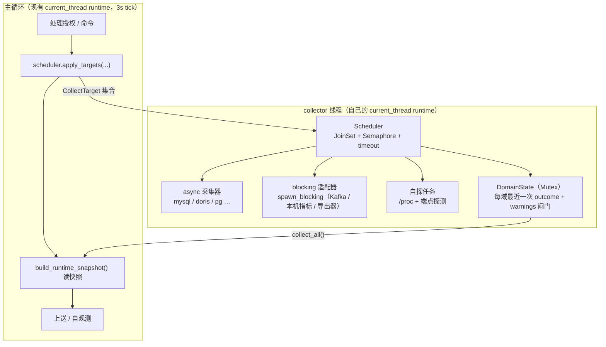

# 采集运行时：统一调度与 async / blocking 双执行器

> 状态：**设计（已评审；P0 待实现）**。决策记录见 §12（1/2/4/6/8 已定，3/5/7 待定），
> P0 的实现边界见 §10。
>
> 范围：**指标采集**（主机 / 进程 / 容器 / Kafka / 关系型数据库 / Doris …）。
> 日志采集不在本文范围（它有自己的 tick + spool 链路）；「导出行」类采集是否复用
> 本文的调度器，留给以后的单独评审。

## 1. 为什么要做

现在 agentd 只有 **Kafka** 一个「外部系统」采集域，它的执行模型是为这一个域手工搭的：

- 一条 `kafka-probe` 线程（`src/telemetry/metrics/kafka.rs::spawn_worker`），
  内部是**同步阻塞**实现（`std::net::TcpStream` + 超时 + 同步 rustls + 手写 SCRAM）；
- 主循环（`src/main.rs`：`#[tokio::main(flavor = "current_thread")]`）只做
  `request_scan` / `collect_outcome` 两次 `Mutex` 交互；
- 主机 / 进程 / 容器指标则在主循环里**同步**采集
  （`src/runtime/daemon.rs` → `process_metrics_tick` → `providers()` → `build_runtime_snapshot_from_view`）；
- 进程 / 端点自探同样是主循环里的同步调用（`DiscoveryProbe::refresh`）。

下一步要接 MySQL / TiDB / PostgreSQL / **Doris**（Doris FE 讲 MySQL 协议，但取的 SQL 完全不同）。
如果照 Kafka 的做法复制，会得到：每个域一条线程、每套超时/预算/重试各写一遍、
每处都要重新想「撤授权怎么停、失败怎么报、基数怎么限」。域一多，这些不一致会变成现场事故。

**结论：统一的是契约、调度、输出与安全边界；执行层保留 `async` 与 `blocking` 两个适配器。**
不追求「所有采集器都改写成 async」——Kafka 的手写协议已经用真机验证过，
数据库驱动则大多有成熟的 async 客户端，两者应当活在同一个调度器下，而不是同一种实现风格里。

## 2. 不变量（不可破）

1. **主循环永不等待采集**。3s tick 只读快照、只投递；任何网络（Kafka / DB）都不得在 tick 上。
2. **不伪造失败**：拿不到就是缺序列，**不补 0**；`kafka_broker_up=0` 这种「假 0」等价于错误结论。
3. **一个目标失败不影响其它目标**；同一目标的错误不拖垮同域其它目标。
4. **撤授权 / 暂停 = 立即停采**，序列从快照消失；在途结果必须按代号丢弃（不得复活）。
5. **凭据不经平台**：密码只从本机固定路径读；不进配置、不进日志、不进诊断包。
6. **端点只来自自探**（`target: "auto"`）：工作单元里写具体地址一律 `unsupported`，
   否则等于给网关开 SSRF 口子。
7. **上限先于功能**：每个域必须有单轮预算、单次超时、序列基数上限；没有上限的域不许上线。
8. **只读**：对 DB 只查系统视图，账号必须只读，查询带服务端超时；对 Kafka 只发 Admin 读 API。
9. **`attempted_targets` / `succeeded_targets` 同口径**：都数**目标**，不混入地址数/请求数。

## 3. 目标 / 非目标

**目标**

- 一个调度器管所有采集目标：周期、超时、预算、并发上限、撤授权、自探扫描。
- 一个 `Collector` 接缝：新增一个域 = 一个 collector + 一组 `wist-metrics` 指标声明 + 一条凭据约定。
- 两种执行适配器，行为对上层**完全一致**（同一个 `ProbeResult`）。
- 采集线程可自愈（panic / 僵死），并如实上报「谁、卡在哪」。
- 所有域的失败语义、告警形态、自观测字段一致。

**非目标**

- 不统一协议编解码；不统一各域要查的 SQL / API。
- 不把日志采集搬进来。
- 不引入中心侧（网关）的采集编排；授权仍走既有采集面（工作单元）。
- 不做「同一个域跨主机采集」——仍然只采 agentd 所在节点上的服务。

## 4. 现状（as-is，供实现时对照）

| 关注点 | 现在在哪 | 备注 |
|---|---|---|
| 调度 | `ProbeRuntime`（`kafka.rs`）：`next_at` + `take_due` + 500ms 空转 | 只能管 Kafka |
| 自探扫描 | `ProbeRuntime.pending_scan` + `scan_epoch` + `finish_scan` | 已从 tick 挪到探测线程 |
| 周期/预算 | `KafkaProbeConfig`（interval / timeout / capacity_budget / group_interval） | 旋钮分散在 `[kafka]` |
| 结果 | `ProbeResult{ targets, attempted, failed, last_error, warnings }` | 形状可复用，位置在 `kafka.rs` |
| 合并上送 | `runtime.rs::build_runtime_snapshot_from_view` → `providers().chain(kafka::collect_outcome())` | 主机三域 + Kafka |
| 日志闸门 | `ProbeLogState`（warnings 内容变化才打） | 只服务 Kafka |
| 告警聚合 | `kafka_groups::GroupWarnings` | 只服务消费组 |
| 凭据 | `/etc/wist-agentd/secrets/kafka/{probe,ca.pem}` | 约定式，不进配置 |
| 授权判据 | `control/work.rs::kafka_grant()`（`collect_metrics` + `KafkaCluster/auto`） | 域专属 |
| 自观测 | `MetricsRuntimeSnapshot.outcomes`（每域一条） | 已通用 |

参考实现的价值集中在三处，迁移时**照抄语义**而不是照抄代码：

1. **一次与主循环的交互只有两次 `Mutex`**（投递请求 / 读结果）；
2. **每轮有总预算，超了少采尾部、留 warning**，不拖死整轮；
3. **撤授权用代号（epoch）作废在途结果**——否则晚到的扫描会把集群加回来。

## 5. 目标架构



关键取舍（已定）：

- **collector 线程自带一个 `current_thread` tokio runtime（已定）**。主循环的 runtime 配置
  （`current_thread`）不动：换全局 runtime 会影响 daemon 所有既有调度（心跳、命令、上送），
  风险与收益不成比例。一条线程 + 内部 async 既拿到了并发多路复用，也保住了「主循环零等待」。
- **`spawn_blocking` 的语义要写在文档和代码注释里**：超时只是**不再等**，阻塞调用仍在跑。
  因此阻塞适配器必须有「僵死目标」检测与上限（§6.4）。
- 自探扫描是**调度器里的一个任务**（不是单独线程），与采集共用预算与撤销语义。

## 6. 契约

### 6.1 目标与策略

```rust
/// 一个采集目标：由「授权（work unit）」+「本机自探」共同决定。
pub struct CollectTarget {
    /// 采集域：`host_metrics` / `kafka_broker_metrics` / `mysql_metrics` / `doris_metrics` …
    pub domain: &'static str,
    /// 稳定身份（会进 `instance`）：自探给的端点摘要 / 集群 id / 数据目录摘要。
    pub key: String,
    /// 工作单元里的来源（`kind` + `target`，`target` 只认 `auto`）。
    pub source: SourceSpec,
    /// 自探结果：地址、协议、TLS 材料引用。
    pub endpoint: Endpoint,
    /// 调优与安全阀（来自授权周期 + `[collect]` 旋钮）。
    pub policy: TargetPolicy,
}

pub struct TargetPolicy {
    pub interval: Duration,
    /// 单次请求超时（进 socket / 驱动）。
    pub timeout: Duration,
    /// 单轮总预算：超了少采尾部并留 warning，绝不拖死其它目标。
    pub budget: Duration,
    /// 序列上限（每域实现各自解释：组数 / 表数 / 分区数）。
    pub max_series: usize,
}

pub struct Endpoint {
    pub addr: String,          // host:port（IPv6 带方括号）
    pub protocol: Protocol,    // PLAINTEXT | TLS | SASL_PLAINTEXT | SASL_SSL（DB 只用到前两种）
    pub credential: Option<CredentialRef>, // 指向固定路径，不含密码
}
```

### 6.2 `Collector`

**已定：P0–P2 用 `enum` 分发**（域少、零分配、没有对象安全顾虑）：

```rust
pub enum Collector {
    Host(HostCollector),
    Kafka(KafkaCollector),
    Mysql(MysqlCollector),
    Doris(DorisCollector),
    // …
}

impl Collector {
    pub fn domain(&self) -> &'static str { /* match */ }

    /// 对一个目标跑一轮；同步实现内部用 `spawn_blocking` 包一层（§6.4）。
    pub fn collect<'a>(
        &'a self,
        target: &'a CollectTarget,
    ) -> Pin<Box<dyn Future<Output = ProbeResult> + Send + 'a>> {
        match self { /* 每个分支返回 ready 或 spawn_blocking 的 future */ }
    }
}
```

<details>
<summary>备选：`trait Collector`（域超过 5 个、需要运行时注册时再切，调用点不变）</summary>

```rust
pub trait Collector: Send + Sync {
    fn domain(&self) -> &'static str;
    fn collect<'a>(
        &'a self,
        target: &'a CollectTarget,
    ) -> Pin<Box<dyn Future<Output = ProbeResult> + Send + 'a>>;
}
```

edition 2024 的 `async fn in trait` 对 `dyn` 不友好，本仓也不打算为这一个场景引入 `async-trait`，
所以切 `dyn` 时用上面的 **boxed future** 形制。

</details>

### 6.3 结果

把 `ProbeResult` 从 `kafka.rs` 提到 `metrics/collection.rs`，保持字段不变：

```rust
pub struct ProbeResult {
    pub targets: Vec<MetricsCollectionTargetSample>,
    /// 本轮**尝试**的目标数：成功时 = `targets.len()`；整轮失败时仍记 1（且 `failed = 1`），
    /// 保证 `succeeded <= attempted`（口径见不变量 9）。
    pub attempted: usize,
    pub failed: usize,
    pub last_error: Option<String>,
    /// 不影响本轮成败、但确实造成样本缺失的原因（按原因聚合后再进来）。
    pub warnings: Vec<String>,
}
```

### 6.4 执行适配器

| | async 原生 | blocking 适配器 |
|---|---|---|
| 谁用 | MySQL / TiDB / Doris / PostgreSQL | Kafka（现有实现）、本机指标、以后只有同步驱动的库（如 Oracle） |
| 超时语义 | future 被 drop，连接归还池，**立即释放** | **只停止等待**；线程继续跑到它自己的 socket/驱动超时 |
| 僵死风险 | 无 | 有：驱动/内核不让中断时线程会一直占着 |
| 处理 | `tokio::time::timeout` | `spawn_blocking` + 「超过 N×预算 → 标 `stalled`、停止为新轮次调度该目标、打一条 `event=CollectorTargetStalled`」；不要假装它被取消 |

`spawn_blocking` 的固定成本（每任务一个 blocking worker）要计入并发上限：`Semaphore` 同时约束
async 与 blocking，默认 8；blocking 任务额外受「同域最多 2 个并发」约束，避免一台机器上的
多个 DB 同时把 worker 池占满。

**超时后 `inflight` 不能立刻清空**：async 实现可以（future 已经被 drop），blocking 实现不行——
任务是「不再等」而不是「已退出」，此时清空会给一个还卡着的目标再排一轮，越积越多。
规则：blocking 目标的 `inflight` 只在**任务真正返回**时清；超过 3× 预算就标 `stalled`，
并停止为它排新轮次，直到旧任务返回（回收后自动恢复）。

### 6.5 调度器

```rust
struct Scheduler {
    /// 当前目标集（授权 + 自探的结果），reconcile 语义与 Kafka 现在一致。
    targets: BTreeMap<(&'static str, String), TargetState>,
    /// 自探代次：撤授权 / 新扫描 +1，晚到的结果丢弃（见 §8.3）。
    scan_epoch: u64,
}

struct TargetState {
    config: CollectTarget,
    next_at: Instant,
    /// 同目标在飞标记：一轮没完成，不再为它排下一轮。
    inflight: bool,
    /// 该目标的告警闸门（内容变化才打日志）。
    log_gate: WarningGate,
    latest: Option<ProbeResult>,
}
```

主循环只调两个方法：

```rust
/// 投递目标集合（授权变化 or 自探结果变化时调用）。幂等。
pub fn apply_targets(targets: Vec<CollectTarget>);

/// 撤授权：停采并作废在途扫描/结果。
pub fn revoke();
```

调度线程的主体（示意）：

```rust
let mut inflight = JoinSet::new();
loop {
    // 1) 收集已完成的结果 → 写 DomainState（同目标释放 inflight）
    // 2) 自探：pending_scan 有值就先跑（受 budget 约束）
    // 3) 为到期且未在飞的目标起任务（受 Semaphore 约束）
    // 4) 退避：睡到「最近一个 next_at」与 500ms 的较小值
}
```

### 6.6 读模型

`DomainState` 用一把 `Mutex` 保护（与现在 `KafkaProbeRuntime` 同构），主循环的
`build_runtime_snapshot_from_view` 改成：

```rust
let outcomes = host_metrics_outcome()          // 仍从 target_view 推导
    .into_iter()
    .chain(collection::collect_all())          // 所有 collector 域的最近一次 outcome
    .collect();
```

`collect_all()` 只 clone 数据、不做 I/O，耗时与域数线性，微秒级。

### 6.7 默认值与上限

| 项 | 默认 | 说明 |
|---|---|---|
| 全局并发（async + blocking 合计） | 8 | `Semaphore`；一台机器很少同时需要 8 路 |
| 同域 blocking 并发 | 2 | 避免多个 DB 同时占满 blocking worker |
| 调度空转 | 500ms | 与现有 Kafka 线程一致；没有到期目标时只拿一次锁 |
| 单次请求超时 | 域自定（Kafka 5s） | 进 socket / 驱动 / 会话 |
| 单轮总预算 | 域自定（Kafka 容量 10s、消费组 20s；DB 建议 5s） | 超预算少采尾部 + warning |
| 僵死判定 | 3 × 预算（且 ≥ 15s） | 只适用于 blocking 适配器 |
| 自探重算 | 5min 或 discovery revision 变化 | 与现一致；在调度线程执行 |

## 7. 各域落点

| 域 | 执行器 | 关键点 |
|---|---|---|
| 主机 / 进程 / 容器 | blocking（现有同步实现） | **目标来源是 `target_view`（发现策略），不是工作授权**；调度器只接管执行，不新造 `*_grant()`；`attempted` 仍按目标数。**已定：P0 一并搬进 collector 线程** |
| Kafka | blocking（现有 `probe_once`） | P0 只做「搬家」：不改协议、不改语义；`capacity_budget` 变成 `TargetPolicy.budget`，消费组周期作为该域自己的子周期（沿用 `group_interval`） |
| MySQL / TiDB | async | `sqlx`（MySQL + rustls，无 C 依赖）或 `mysql_async`；只读账号 + `SET SESSION MAX_EXECUTION_TIME` / `statement_timeout`；查 `information_schema` + `SHOW GLOBAL STATUS` |
| Doris | async（**复用 MySQL transport**） | 与 MySQL **不是同一个 collector**：Doris 的读数是 `SHOW BACKENDS` / `SHOW PROC '/backends'` / `information_schema` 里的 tablet·副本视图。transport 复用、SQL 与指标映射各自实现 |
| PostgreSQL（可选） | async | `sqlx` / `tokio-postgres`；`pg_stat_*` |

命名与注册：每个域在 `wist-metrics::spec` 里登记 `collection_kind` 与指标（前缀 `<namespace>_`），
`src/telemetry/metrics/kafka.rs::every_emitted_fact_is_registered_in_the_metric_spec` 那类
「覆盖完整性」测试要复制到每个新域。

## 8. 授权、自探与凭据

### 8.1 授权

沿用既有采集面：工作单元 `capability = collect_metrics`，`sources` 里带域来源：

```json
{"units":[{
  "unit_id":"kafka-broker",
  "capability":"collect_metrics",
  "rule_ref":"kafka-broker",
  "requires_privilege":"none",
  "sources":[
    {"kind":"KafkaCluster","target":"auto"},
    {"kind":"MetricInterval","target":"30s"}
  ]
}]}
```

- 新的来源 kind（`SqlEndpoint` / `DorisCluster` …）最终要收进 `wist-contracts`，
  并连带 `wist-api` / `wist-metrics` / `wist-validate` 四个仓切 path 发版（与 Kafka 当初同一流程）。
  **P0 不碰 contracts**：先在 agentd 内的 `control/work.rs` 定义，等网关开始派发再收口。
- 每个域一个 `*_grant()` 判据，形状照抄 `kafka_grant()`：有生效工作 + 单元里有该域来源 + `target` 只认 `auto`。

### 8.2 自探（端点只来自本机）

| 域 | 证据（从强到弱） |
|---|---|
| Kafka（已实现） | `server.properties` → 容器 `KAFKA_CFG_*` → 监听端口 |
| MySQL / TiDB | `my.cnf` / `mysqld` argv（`--port`、`--socket`）→ 容器 `MYSQL_*`/`MARIADB_*` → 监听端口 |
| PostgreSQL | `postgresql.conf` / `-D` 数据目录 / 端口 → 容器 `PGPORT` → 监听端口 |
| Doris | `fe.conf` / `be.conf`（`http_port`、`rpc_port`、`query_port`）→ 容器 env → 监听端口 |

共性：**只读白名单键**（`port`、`listener`、`data_dir`、`http_port` 等），
`*.password`、`sasl.jaas.config`、`pg_hba.conf` 一律不读不报；结果只在本机使用，
不上报、不进网关。`doctor` 每域一个检查项（`discovery.<domain>`）。

**已定：DB 域也只认 `auto`（本机自探），不提供显式地址入口。** 以后若要支持采集远端库，
必须先单独评审 SSRF 与会话边界（相当于把 agentd 变成一个通用的数据库探针），不在本设计的范围内。

### 8.3 撤授权与在途结果

与 Kafka 现有实现同构：`apply_targets`/`revoke` 各自递增 `scan_epoch`；
任务回来时代号不匹配就丢弃。**这条是硬要求**：主循环只在「授权存在 → 不存在」切换时调用一次
`revoke`，晚到的结果没有第二次纠正机会。

### 8.4 凭据

```
/etc/wist-agentd/secrets/<domain>/<target-key>/{password,ca.pem}
```

- **单实例域可省略 `<target-key>`**：Kafka 现在就是 `/etc/wist-agentd/secrets/kafka/probe`
  （目标是 `auto`，一机一个）；这条路径必须继续兼容，新域按带 key 的形式落地；
- `<target-key>` 必须与 `CollectTarget.key` 同一口径（可预测、可脚本投放）；
- 密码永远只在 collector 建连前读、读完即弃；
- 「接入 <域>」页面沿用 Kafka 那套：**只给可复制的命令**，密码在浏览器生成、平台不接收不保存；
- DB 场景额外要求：**账号只读**、`statement_timeout` 必须由服务端/会话设置双重保障。

## 9. 失败语义与可观测

### 9.1 结果状态

| 情形 | outcome.status | 样本 |
|---|---|---|
| 全部目标成功 | `succeeded` | 全量 |
| 部分目标失败（其余成功） | `partial` | 成功的照常 |
| 全部目标失败（连不上 / 认证失败） | `failed` | 无（**不补 0**） |
| 单目标的部分读数缺失（如某 broker 的容量） | 仍 `succeeded`（或 `partial`，仅当有目标级失败） | 缺的那条不发 + warning |
| 授权到了但首轮还没跑完 | `pending` | 无 |

### 9.2 日志

| 事件 | 频率 |
|---|---|
| 域专属启停：Kafka 仍是 `event=KafkaProbeEnabled/Revoked` | 该域目标集合变化时 |
| 域专属告警：`event=KafkaProbeWarning` / `event=<Domain>ProbeWarning` | 告警内容变化时（按原因聚合，见下） |
| `event=CollectorTargetStalled target=… budget=…` | blocking 目标超过 N×预算（**新增**） |
| `event=CollectorThreadRestarted reason="panic: …"` | 线程自愈时（**新增**，必须带 panic 摘要） |
| 域级成败 | 仍由 `MetricsCollectionFailed/Partial/Recovered` 统一打（不重复） |

> 命名原则：**域专属事件保留现有名字**（现场脚本/告警可能按 `KafkaProbeWarning` grep），
> 只有调度器级的新事件才用 `Collector*` 前缀。

告警聚合规则沿用 `kafka_groups::GroupWarnings`：**原因里不带目标名**，单目标保留原句，
多目标写 `N 个目标（如 a, b, c…）<原因>`。P0 把它提到 `metrics/collection.rs` 成为通用工具。

### 9.3 自观测

`metrics_runtime` 行已带 `attempted/succeeded/failed/failures/last_error`，多域后语义不变；
每域一条 outcome。另加两个字段（破坏性很小的新增）：

- `stalled_targets`：当前被判僵死的目标数；
- `collector_restarts`：采集线程自愈次数（进程生命周期内累计）。

### 9.4 线程自愈

- 调度线程体包 `catch_unwind`：panic 后记 `event=CollectorThreadRestarted`，复位状态并重新拉起；
- 复用现有 `worker_started` 的坑（现在 panic 后永不再起）——新实现里「已启动」标志必须由
  **看护者**维护，而不是由线程自己维护。

## 10. 迁移计划（P0–P3）

### P0：抽出接缝，行为不变（唯一必须完成的一步）

**改动清单**

| 文件 | 动作 |
|---|---|
| `src/telemetry/metrics/collection.rs`（新） | `CollectTarget` / `TargetPolicy` / `ProbeResult` / **`enum Collector`** / `WarningGate` / `GroupWarnings`（从 kafka 提上来） |
| `src/telemetry/metrics/scheduler.rs`（新） | collector 线程 + `current_thread` runtime + `apply_targets` / `revoke` / `collect_all` / 自探任务 / 自愈；按 `enum` 分发 |
| `src/telemetry/metrics/kafka.rs` | 删掉 `spawn_worker` / `RUNTIME` / `take_due`；`probe_once` 原样包成 blocking collector；`GroupCache` 变成该目标的私有状态 |
| `src/telemetry/metrics/runtime.rs` | `chain(kafka::collect_outcome())` → `chain(collection::collect_all())` |
| `src/telemetry/metrics/mod.rs` | 注册两个新模块 |
| `src/runtime/daemon.rs` | `kafka::request_scan(...)` → `scheduler::apply_targets(...)`；`kafka::revoke()` → `scheduler::revoke()`；主机指标 tick 采集改为读快照 |
| `src/runtime/daemon_metrics.rs` | 只改 `process_metrics_tick` 的取数来源（不再现场采集） |

**验收**

- 现网行为不变：Kafka 真集群 `kafka_live` 9/9；`attempted/succeeded`、lag/state/容量读数与现在一致；
- 主机指标（`host_metrics` / `process_metrics` / `container_metrics`）在快照里的结构、`instance`、
  取值与 P0 前一致，上送节奏不变；
- 撤授权 → 下个 tick 内序列消失；自探扫描仍在后台线程，3s tick 无网络等待（可用「给假 broker 加 5s 延迟」测主循环时间）；
- 线程 panic（测试里注入）后 5s 内自动恢复并打 `CollectorThreadRestarted`；
- `cargo test --lib` 全绿；`clippy -D warnings`、`fmt --check` 干净。

### P1：MySQL / TiDB（第一个 async 域）

- `wist-metrics` 新增 `mysql_metrics` 指标声明（连接数、QPS/TPS、慢查询、InnoDB buffer pool、复制延迟…先选 P0 子集）；
- 新 collector：`sqlx`（MySQL + rustls）连接池、只读查询、会话级超时；
- 凭据：`/etc/wist-agentd/secrets/mysql/<key>/password`；自探：`my.cnf`/argv/env/端口；
- 授权：agentd 内先定 `SqlEndpoint`，`target` 只认 `auto`；
- 验收：真机（开发库）live 用例 全绿；断网/错密码/无权限三种失败各自可定位；基数上限生效。

### P2：Doris（复用 transport）

- `doris_metrics`：`SHOW BACKENDS`（BE 存活/磁盘/tablet 数）、`SHOW PROC '/backends'`（compaction/rowset）、
  FE 的 `information_schema`（表/分区基数）；
- 与 MySQL 共用连接池实现，但 SQL 与指标映射独立；
- 验收：BE 宕机 → 该 BE 的序列消失（不补 0）；compaction 积压可观测。

### P3（可选）：Kafka 协议 async 化

只有出现「同机多 Kafka 集群 / 需要并发多目标」时才做；`Collector` 边界已经把影响面限制在一个文件内。

## 11. 测试策略

- **单元**：调度（到期 / 在飞 / 撤授权代号）、预算（超预算少采尾部）、告警聚合、状态机（succeeded/partial/failed/pending）。
- **假服务端**：沿用 `kafka.rs` / `kafka_groups/tests.rs` 的「假 broker」模式；
  DB 侧用同一思路做「假 MySQL 握手 + 固定结果集」，或直接对 collector 的**查询层**做接口注入。
- **真机（只读）**：照 `dev/kafka-sasl` 做 `dev/mysql`、`dev/doris` 的 `#[ignore]` live 套件，
  环境变量指向开发库；CI 里跳过。
- **故障注入**：连接拒绝 / 认证失败 / 无权限 / 查询超时 / 半包 / 巨型响应（上限必须拒绝而不是 OOM）。
- **韧性**：采集线程 panic 自愈、blocking 目标僵死检测、撤销与在途结果竞态。
- **不变量回归**：每个域都要有「不伪造 0」和「attempted 与 succeeded 同口径」的用例。

## 12. 决策记录

### 12.1 已定（2026-11-05）

| # | 决定 | 落地含义 |
|---|---|---|
| 1 | **`enum Collector`** | §6.2 按 `enum` 实现；`trait` 形制仅作备选（域 >5 个再切） |
| 2 | **collector 专属线程 + `current_thread` runtime** | 主 runtime 不动；与主循环只通过 `Mutex` 快照交互 |
| 4 | **DB 端点也只认 `auto`**（本机自探） | 不新增显式地址入口，SSRF 面不扩大；远端库采集需单独设计 |
| 6 | **contracts 分批收口** | 每个域在其网关开始派发时才进 `wist-contracts`；P0/P1 都先在 agentd 内定义，四个仓不同时动 |
| 8 | **主机指标也进 collector 线程** | P0 一并搬；上送侧要接受「快照最多比 tick 晚一拍」 |

### 12.2 待定（P1 启动前定）

| # | 待定 | 默认倾向 / 需要的输入 |
|---|---|---|
| 3 | **DB 驱动** | 先在 musl 静态发布下核对 `sqlx`（`default-features = false` + `runtime-tokio` + `tls-rustls` + `mysql`/`postgres`）是否引入 C 依赖；不行则 `mysql_async` + `tokio-postgres` 两套 |
| 5 | **凭据目录的 `<target-key>`** | 倾向复用自探身份的稳定摘要（如 `port-3306` / 集群 id），保证「可预测、可脚本投放」；多实例命名冲突时再调整 |
| 7 | **Doris 的 P0 指标子集** | 倾向先做 BE 存活/容量/tablet（不依赖审计日志）；查询延迟类指标等与 Doris 版本对齐后再定 |

## 13. 一个域的最小落地清单（checklist）

新增一个采集域需要动的地方（照此逐项打勾，缺一项就会在现场表现为「没数据」或「假数据」）：

- [ ] `wist-metrics`：`collection_kind` + 指标声明 + label 闭集（`find_metric_spec` 能查到）；
- [ ] `Collector` 实现：端点 → 连接 → 查询 → `ProbeResult`（facts 名称与上面的声明一致）；
- [ ] 自探：证据层 + 只读白名单键 + 可达性探测（≤300ms/端点）+ 排除项（同类但不是该服务的进程）；
- [ ] 凭据：固定路径 + 只读账号 + 会话超时；
- [ ] 授权：`*_grant()`（`collect_metrics` + 本域来源 + `auto`）；
- [ ] 策略：`interval` / `timeout` / `budget` / `max_series` / 白名单；
- [ ] 失败语义：不补 0、按目标隔离、告警按原因聚合；
- [ ] 自观测：`event=<Domain>ProbeWarning`、`MetricsCollection*`、`doctor` 的 `discovery.<domain>`；
- [ ] 测试：假服务端 + 四种失败注入 + live（`#[ignore]`）+ 不变量回归；
- [ ] 文档：本目录一份 `<domain>-collection.md`（协议/查询/口径/上限）+ 「接入 <域>」页面帮助代码。

## 14. 交接（新 session 从这里开始）

**先读**（顺序）：

1. 本文（尤其 §6 契约、§10 P0 改动清单、§12 决策记录）；
2. `kafka-self-discovery.md` —— 授权驱动 + 自探的硬约束（`target=auto`、不上报、撤授权即停）；
3. `kafka-sasl-implementation.md` §8 / §11 —— 现有探针的失败语义、预算与告警形态（P0 要照抄语义）；
4. `src/telemetry/metrics/kafka.rs` 的 `ProbeRuntime`（`reconcile`/`take_due`/`pending_scan`/`scan_epoch`/`finish_scan`）
   —— **这就是要抽象成调度器的那份状态机**。

**第一步只做 P0**：

- 已定口径：`enum Collector`、collector 专属 `current_thread` 线程、主机指标一并搬、
  contracts **不动**（DB 域的分批收口留到各自网关开始派发时）；
- 不改 Kafka 协议、不改任何指标口径；
- 新代码只出现在 `metrics/collection.rs` + `metrics/scheduler.rs`，其余文件是「搬移 + 接线」；
- 完成标志：§10 P0 验收 5 条全过，Kafka 真集群 `kafka_live` 9/9；
- 回填本文 §10 的验收，并在 `CHANGELOG.md` 记一行「采集运行时 P0（行为不变）」。

**P0 之后**：先定 §12.2 的 3 / 5 / 7，再开 P1（MySQL/TiDB）。
