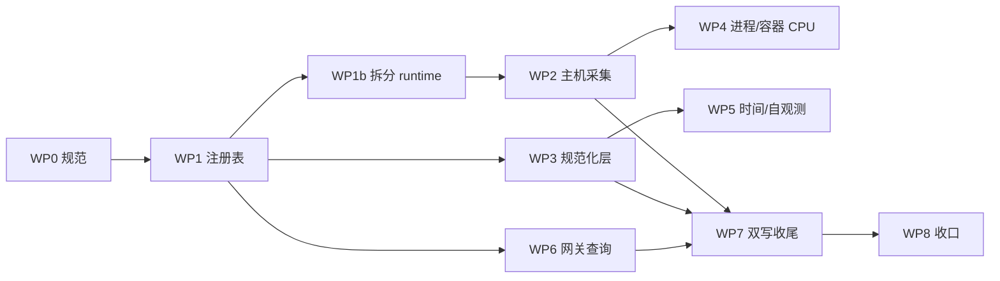

# 指标数据规范 v1 落地计划

> 依据 [metrics-data-spec.md](./metrics-data-spec.md)（v1）。本文只回答：**分几批、在哪个分支、按什么顺序、谁来验收**。

## 1. 总原则

1. **一个工作包 = 一个分支 = 一个仓库**，不跨仓混提交。
2. **写范围互斥**：同一时刻只有一个包改同一个文件（§3 给出文件归属表）。
3. **先契约、后采集、再消费**：注册表是所有包的公共依赖，必须先合入并在下游锁版本。
4. **破坏性变更按规范 §0.1**：指标名双写 7 天；label 改名不做双写（理由见 §5）。
5. 每个包完成 = 代码 + 测试 + `CHANGELOG.md` 条目 + 文档同步。

## 2. 分支与合并

| 仓库 | 类型 | 基线分支 | 工作分支 | 合并方式 | 发布 |
|---|---|---|---|---|---|
| `wist-metrics` | 组件（lib） | `main` | `feat/metrics-<wp>` | PR → `main` | `gx adm v_feat` + `gx adm v_tag` |
| `wist-agentd` | 制品（bin） | `alpha` | `feat/metrics-<wp>` | PR → `alpha` | `gx adm v_feat` + `tag_alpha`（按需） |
| `wist-gateway` | 制品（bin） | `alpha` | `feat/metrics-<wp>` | PR → `alpha` | 同上 |

约定：

- 分支从基线拉，合并前 `rebase` 基线；合并后删除分支。
- 命名带工作包编号（`feat/metrics-wp3-normalize`），便于对照本文。
- 本地联调用 `[patch.crates-io]` path（`wist-agentd/Cargo.toml` 已留注释块），**不得提交**；PR 前用 `git diff` 自查。
- 提交前必过：`gx run lint`、`gx run test -e debug`（仓库既有门禁）。

## 3. 工作包

| ID | 仓库 | 分支 | 写范围（文件锁） | 依赖 | 规模 | 状态 |
|---|---|---|---|---|---|---|
| WP0 | `wist-agentd` | `docs/metrics-spec-v1` | `docs/design/metrics-data-spec.md`、`docs/design/README.md` | — | S | 已合入 `alpha` |
| WP1 | `wist-metrics` | `feat/metrics-wp1-registry` | `src/spec.rs`、`src/provider.rs`（文档） | WP0 | M | 已发布 `0.6.0`（`main`） |
| WP1b | `wist-agentd` | `refactor/metrics-split-runtime` | `src/telemetry/metrics/runtime.rs` → `mod host; mod process; mod container;`（**纯搬移**） | WP1 | S | 已合入 `alpha`（`runtime/{host,process,container}.rs`） |
| WP2 | `wist-agentd` | `feat/metrics-runtime-v1` | `src/telemetry/metrics/runtime.rs`、`Cargo.toml`（依赖版本） | WP1 | L | 已合入 `alpha`（Linux + macOS 磁盘 I/O） |
| WP3 | `wist-agentd` | `feat/metrics-runtime-v1` | `src/telemetry/metrics/samples.rs`、`src/config/*`、`src/reporting/exporter.rs` | WP1 | L | 已合入 `alpha`（`0.19.0-alpha`） |
| WP4 | `wist-agentd` | `feat/metrics-runtime-v1` | `src/telemetry/metrics/runtime.rs`（进程/容器 CPU） | WP2 | M | 已合入 `alpha`（Linux） |
| WP5 | `wist-agentd` | `feat/metrics-runtime-v1` | `src/runtime/daemon_metrics.rs`、`src/telemetry/metrics/self_obs.rs` | WP3 | S | 已合入 `alpha`（时间戳 + 自观测指标） |
| WP6 | `wist-gateway` | `feat/metrics-wp6-query` | `src/api/host_metrics.rs`、`src/api/agent_ops.rs` | WP1 | M | 已合入 `alpha`（`0.35.0-alpha`） |
| WP7 | 三仓 | `chore/metrics-drop-legacy` | 各仓被 WP1/WP2/WP3/WP6 改过的文件 | WP2…WP6 上线 ≥ 7 天 | S | 未开始 |
| WP8 | `wist-agentd` | `docs/metrics-rollout-close` | 本文、`docs/design/README.md`、各仓 `CHANGELOG.md` | WP7 | S | 未开始 |

### WP1 注册表 v1（`wist-metrics`）

- `MetricSpec` 扩列：`name` / `unit` / `value_type` / `const_labels` / `dynamic_labels` / `semconv_ref` / `deprecated`；
- `METRIC_SPECS` 全量换 snake_case，按规范 §10 表格逐列填写（fact_key / name / type / unit / 常量与动态 label / semconv_ref）；
- 旧名集中放在独立的 `LEGACY_METRIC_SPECS` 表（`fact_key` 以 `legacy.` 前缀、保留旧单位），与 v1 表物理隔离，双写期结束整表删除；
  理由：v1 表保持“只有规范名”，门禁测试不会因为混入旧拼写而放宽规则，删除时也不需要逐条摘标记。
- 新增门禁测试：名字文法、单位后缀双向校验、单位/类型闭集、`(域, fact_key)` 与 `name` 唯一、比例取值范围。
- 验收：`gx run lint`、`cargo test`；`gx adm v_feat` 后 `gx adm v_tag`。

### WP2 主机采集（`wist-agentd`）

- Linux `/proc/stat` 逐核逐 mode；macOS `host_statistics`；单位换算在采集侧；
- 内存：`usage_ratio` + swap 总量/剩余；磁盘：`device` 维度 I/O 计数；inodes；
- fact 名统一单位中立（`host.cpu.seconds` 等）；
- 验收：单测覆盖解析与换算（含 `/proc/stat` 8 字段、guest 不重复计）、本地 `metrics.jsonl` 可见新序列。

### WP3 规范化层（`wist-agentd`）

- label 闭集与白名单；去 `unit` label；`disk_role` 常量 label；
- 失败目标不上送；采样上限 + `dropped` 记账 + 确定性选样；
- 时间取采集完成时刻；解析失败丢弃并记事件；
- 本地落盘与线格式同构；
- 验收：§12.2 门禁逐条落成测试。

### WP4 进程/容器 CPU

- Linux `/proc/<pid>/stat` utime+stime；容器用 cgroup `usage_usec`；
- 复用 `investigate_load.rs` 的 cgroup 读取与 jiffies 换算经验；
- 验收：与 `/proc` 手算值一致（误差 < 1%）。

### WP5 时间与自观测

- 快照记录采集完成时刻，`collected_at` 与 VM `timestamps` 同源；
- `agent_uplink_metrics_failed_total` 计数；
- 自观测组（`agent_cpu_ratio` / `agent_cpu_cores` / `agent_memory_bytes` / `agent_admin_latency_seconds` / `agent_discovery_policy_version`）与采集记账共享 `instance` 为空的同一组；
- 验收：断言同一批次所有样本时间戳一致，且等于采集结束时刻；拿不到的读数不发而不是补 0。

### WP6 网关查询适配

- 名称切到新规则，语义化 label（`instance` / `mountpoint` / `disk_role`）；
- 双写期**先读新名、回退旧名**，保证看板不断；
- `agent_ops` 的 `agent_*` 名称与单位口径同步；
- 验收：旧数据（仅旧名）与新数据（双名）都能出图。

### WP7 双写收尾

- 删除 `deprecated` 注册表条目、采集侧旧名、网关旧名回退；
- 删除前确认：旧名在 VM 中 7 天无新写入。

## 4. 顺序与并行

- **串行**：WP1 → WP1b（两者决定后续文件边界，必须先落）。
- **并行**：WP2 / WP3 / WP6 三条线同时开（文件互不重叠）。
- **必须串行**：WP4 依赖 WP2（同属采集侧）；WP5 依赖 WP3。
- WP7 必须在 WP2/WP3/WP6 全部上线后 ≥ 7 天。

## 5. 双写与切换策略

| 变更类型 | 策略 | 理由 |
|---|---|---|
| 指标名（`system.memory.total` → `system_memory_total_bytes`） | 采集侧双写 7 天；网关先读新名、回退旧名 | 名称是历史连接键，双写让看板平滑迁移 |
| 单位/数值换算（KiBy→By、percent→ratio） | 视为改名，随双写一起切 | 同名不同单位会裂序列，必须换名 |
| label 改名（`kind`/`mount`/`target_ref` → `instance`/`mountpoint`/`disk_role`） | **不双写**，与网关同版本窗口切换 | 双写会让序列翻倍且查询双计；label 变更影响面局限在网关 API |
| 失败样本不上送、时间戳口径 | 直接生效 | 不改变序列身份 |
| 选择类 label `app` 缺失 | 直接生效 | 用 `{app=""}` 可识别，无需过渡 |

切换窗口内的验收口径：**同一台机器在 15 分钟内应同时能看到旧名与新名，且数值一致**；label 切换后旧名不再新增数据。

## 6. 风险与回滚

| 风险 | 触发点 | 处置 |
|---|---|---|
| 双写导致写入量翻倍 | WP2 上线后 VM 写放大 | 只对网关消费的名称双写，其余一次性切换 |
| 网关读到混合口径 | label 切换窗口 | 网关同版本发布，回滚时连带 agentd 一起回滚 |
| `app` 大面积留空 | 发现层未识别 | 用 `{app=""}` 统计比例；网关补登记，不回退到"猜一个" |
| 采样上限更严导致丢目标 | WP3 | 先按当前上限（3）记账观察一周，再决定是否调大 |
| `wist-metrics` 版本不一致出现两份 crate | 本地 path 联调忘记还原 | PR 前 `git diff` 检查 `[patch.crates-io]` 与依赖行 |

## 7. 验收清单（每个 WP 通用）

1. `gx run lint` 无告警；
2. `gx run test -e debug` 通过；
3. 新增/修改的规范条款已在 `metrics-data-spec.md` 有出处（不得出现"代码比文档多"）；
4. `CHANGELOG.md` 有一条面向使用者的说明；
5. 双写/切换类改动附一条验证记录（旧名与新名数值一致的时间段）。
