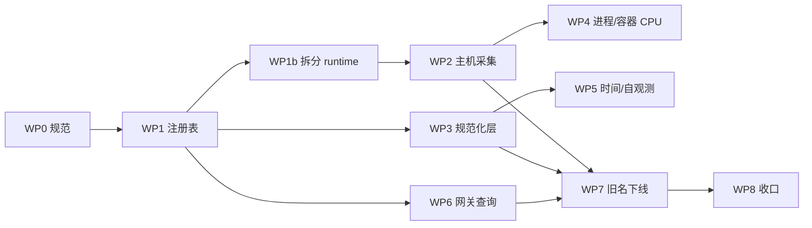

# 指标数据规范 v1 落地计划

> 依据 [metrics-data-spec.md](./metrics-data-spec.md)（v1）。本文只回答：**分几批、在哪个分支、按什么顺序、谁来验收**。

## 1. 总原则

1. **一个工作包 = 一个分支 = 一个仓库**，不跨仓混提交。
2. **写范围互斥**：同一时刻只有一个包改同一个文件（§3 给出文件归属表）。
3. **先契约、后采集、再消费**：注册表是所有包的公共依赖，必须先合入并在下游锁版本。
4. **破坏性变更按规范 §0.1**：同名不同口径不并存，采集侧与查询侧同一版本窗口直接切换。
5. 每个包完成 = 代码 + 测试 + `CHANGELOG.md` 条目 + 文档同步。

## 2. 分支与合并

| 仓库 | 类型 | 基线分支 | 工作分支 | 合并方式 | 发布 |
|---|---|---|---|---|---|
| `wist-metrics` | 组件（lib） | `main` | `feat/metrics-<wp>` | PR → `main` | `gx adm v_feat` + `gx adm tag_stable` |
| `wist-agentd` | 制品（bin） | `alpha` | `feat/metrics-<wp>` | PR → `alpha` | `gx adm v_feat` + `tag_alpha`（按需） |
| `wist-gateway` | 制品（bin） | `alpha` | `feat/metrics-<wp>` | PR → `alpha` | 同上 |

约定：

- 分支从基线拉，合并前 `rebase` 基线；合并后删除分支。
- 命名带工作包编号（`feat/metrics-wp3-normalize`），便于对照本文。
- 本地联调用 `[patch.crates-io]` path（`wist-agentd/Cargo.toml` 已留注释块），**不得提交**；PR 前用 `git diff` 自查。
- 提交前必过：`gx run lint`、`gx run test -e debug`（仓库既有门禁）。

## 3. 工作包

| ID | 仓库 | 分支 | 写范围（文件锁） | 依赖 | 规模 | 状态 |
|---|---|---|---|---|---|---|
| WP0 | `wist-agentd` | `docs/metrics-spec-v1` | `docs/design/metrics-data-spec.md`、`docs/design/README.md` | — | S | 已合入 `alpha` |
| WP1 | `wist-metrics` | `feat/metrics-wp1-registry` | `src/spec.rs`、`src/provider.rs`（文档） | WP0 | M | 已发布 `0.6.0`（`main`） |
| WP1b | `wist-agentd` | `feat/metrics-self-obs` | `src/telemetry/metrics/runtime.rs` → `mod host; mod process; mod container;`（**纯搬移**） | WP1 | S | 已合入 `alpha`（`0.20.0-alpha`；`runtime/{host,process,container}.rs`） |
| WP2 | `wist-agentd` | `feat/metrics-runtime-v1`、`feat/metrics-self-obs` | `src/telemetry/metrics/runtime/*`、`Cargo.toml`（依赖版本） | WP1 | L | 已合入 `alpha`（`0.20.0-alpha`；Linux + macOS 磁盘 I/O） |
| WP3 | `wist-agentd` | `feat/metrics-runtime-v1`、`feat/metrics-self-obs` | `src/telemetry/metrics/samples.rs`、`src/config/*`、`src/reporting/exporter.rs` | WP1 | L | 已合入 `alpha`（`0.20.0-alpha`） |
| WP4 | `wist-agentd` | `feat/metrics-runtime-v1` | `src/telemetry/metrics/runtime/process.rs`（进程/容器 CPU） | WP2 | M | 已合入 `alpha`（`0.19.0-alpha`，Linux） |
| WP5 | `wist-agentd` | `feat/metrics-self-obs` | `src/runtime/daemon_metrics.rs`、`src/telemetry/metrics/self_obs.rs` | WP3 | S | 已合入 `alpha`（`0.20.0-alpha`；时间戳 + 自观测指标） |
| WP6 | `wist-gateway` | `feat/metrics-wp6-query` | `src/api/host_metrics.rs`、`src/api/agent_ops.rs` | WP1 | M | 已合入 `alpha`（`0.35.0-alpha`） |
| WP7 | 三仓 | `chore/metrics-drop-legacy` | `wist-metrics/src/spec.rs`、`runtime/host.rs`、`runtime/process.rs`、`wist-gateway/src/api/host_metrics.rs` | WP2…WP6 | S | 已完成（断点式下线） |
| WP8 | `wist-agentd` | `docs/metrics-rollout-close` | 本文、`docs/design/README.md`、各仓 `CHANGELOG.md` | WP7 | S | 未开始 |
| WP9 | 三仓 | `feat/metrics-selection-labels` | 网关接口/存储、`wist-api` 类型、agent 拉取与命令 | WP6 | L | 已完成（`wist-api` 0.10.x / `wist-validate` 0.7.0） |
| WP10 | `wist-agentd` + `wist-gateway` | `feat/metrics-label-inference` | 事实补 unit/容器名；注册表；`app`/`role` 推断 | WP9 | M | 已完成（`fact-v4`；launchd / 镜像名待补） |
| WP11 | `wist-gateway` | `feat/metrics-label-admin` | 批量编辑 / 管理页面 | WP10 | S | 未开始（P3） |

### WP1 注册表 v1（`wist-metrics`）

- `MetricSpec` 扩列：`name` / `unit` / `value_type` / `const_labels` / `dynamic_labels` / `semconv_ref`；
- `METRIC_SPECS` 全量换 snake_case，按规范 §10 表格逐列填写（fact_key / name / type / unit / 常量与动态 label / semconv_ref）；
- 注册表只保留规范名：旧名（点分写法）与 `legacy.` fact 已整体下线，`find_metric_spec` 不再回退；
  理由：断点式切换后线上只允许一套口径，注册表里留旧名就等于留一条永远不会再被删除的分支。
- 新增门禁测试：名字文法、单位后缀双向校验、单位/类型闭集、`(域, fact_key)` 与 `name` 唯一、比例取值范围。
- 验收：`gx run lint`、`cargo test`；`gx adm v_feat` 后 `gx adm tag_stable`。

### WP2 主机采集（`wist-agentd`）

- Linux `/proc/stat` 逐核逐 mode；macOS `host_statistics`；单位换算在采集侧；
- 内存：`usage_ratio` + swap 总量/剩余；磁盘：`device` 维度 I/O 计数；inodes；
- fact 名统一单位中立（`host.cpu.seconds` 等）；
- 验收：单测覆盖解析与换算（含 `/proc/stat` 8 字段、guest 不重复计）、本地 `metrics.jsonl` 可见新序列。

### WP3 规范化层（`wist-agentd`）

- label 闭集与白名单；去 `unit` label；`disk_role` 常量 label；
- 失败目标不上送；采样上限 + `dropped` 记账 + 确定性选样；
- 时间取采集完成时刻；解析失败丢弃并记事件；
- 本地落盘与线格式同构；
- 验收：§12.2 门禁逐条落成测试。

### WP4 进程/容器 CPU

- Linux `/proc/<pid>/stat` utime+stime；容器用 cgroup `usage_usec`；
- 复用 `investigate_load.rs` 的 cgroup 读取与 jiffies 换算经验；
- 验收：与 `/proc` 手算值一致（误差 < 1%）。

### WP5 时间与自观测

- 快照记录采集完成时刻，`collected_at` 与 VM `timestamps` 同源；
- `agent_uplink_metrics_failed_total` 计数；
- 自观测组（`agent_cpu_ratio` / `agent_cpu_cores` / `agent_memory_bytes` / `agent_admin_latency_seconds` / `agent_discovery_policy_version`）与采集记账共享同一个 `instance`（与主机指标一致的 host resource id，用于关联 `system_host_info`）；
- 验收：断言同一批次所有样本时间戳一致，且等于采集结束时刻；拿不到的读数不发而不是补 0。

### WP6 网关查询适配

- 名称切到新规则，语义化 label（`instance` / `mountpoint` / `disk_role`）；
- 只读新名；旧名回退已删除（旧版本 agent 的旧名不再展示）；
- `agent_ops` 的 `agent_*` 名称与单位口径同步；
- 验收：旧数据（仅旧名）与新数据（双名）都能出图。

### WP7 旧名下线（已完成）

断点式切换：注册表删除旧名、采集侧停止产出 `legacy.*`、网关删除旧名回退，三仓同一批提交。
不再安排双写期与观察期。

下线后仍要确认两件事：

1. **新名持续有数据**（采集与查询都正常）；
2. **旧名不再新增**（除尚未升级的旧版本 agent）。

用 [`dev/verify-metrics-legacy-drop.py`](../../dev/verify-metrics-legacy-drop.py) 检查（只依赖 Python 3；查询依赖 MetricsQL 的 `tlast_over_time`）：

```bash
# 看窗口内是否还有旧名在写（退 0 表示已干净；窗口 ≥ 2× 采集间隔）
dev/verify-metrics-legacy-drop.py --vm-url http://vm.example:8428 --window 24h

# 机器可读输出（CI / 发布流水线判断）
dev/verify-metrics-legacy-drop.py --vm-url http://vm.example:8428 --json --window 24h

# 改脚本本身时先跑自检（内置假 VM，覆盖三种判定）
dev/verify-metrics-legacy-drop.py --self-test
```

退出码：`0` 无旧名新增；`1` 仍有旧名在写（列出名字、点数、最后写入时间、还在写的 agent，
据此定位漏升级的机器）；`2` 查询失败 / 参数错误；`3` 保留期自检不通过
（窗口内连**新名**都没数据，结论不可信）。

> **注意名字层次**：`legacy.*` 是 agent 内部的 `fact_key` 前缀，不会出现在 VM 里。
> VM 里要检查的是它们规范化后的**旧指标名**（如 `system.memory.total`）。
> 脚本按「名字含 `.` 且属于 `system.` / `process.` / `container.` / `agent.` 命名空间」识别旧名——
> 规范名不允许含 `.`，所以这个判据不依赖手写清单。
>
> 为什么不用 `timestamp(last_over_time(...))`：MetricsQL 里它返回的是上卷时间，不是原始样本时间；
> 要用 `tlast_over_time(...)` 才能拿到真正的最后写入时刻。

## 4. 顺序与并行



- **串行**：WP1 → WP1b（两者决定后续文件边界，必须先落）。
- **并行**：WP2 / WP3 / WP6 三条线同时开（文件互不重叠）。
- **必须串行**：WP4 依赖 WP2（同属采集侧）；WP5 依赖 WP3。
- WP7 必须在 WP2/WP3/WP6 全部完成之后（否则会删掉还在依赖的旧名）。

## 5. 切换策略

| 变更类型 | 策略 | 理由 |
|---|---|---|
| 指标名（`system.memory.total` → `system_memory_total_bytes`） | 采集侧与查询侧同一版本窗口直接切换，**不双写** | 双写让写入量翻倍、按名字求和时双计，且只是把迁移成本延后；接受历史断档后一次切干净 |
| 单位/数值换算（KiBy→By、percent→ratio） | 随改名一起切，旧名整体删除 | 同名不同单位会裂序列，必须换名 |
| label 改名（`kind`/`mount`/`target_ref` → `instance`/`mountpoint`/`disk_role`） | 与名字同版本窗口切换 | 两者同属查询面，分两次改让消费方付两次成本 |
| 失败样本不上送、时间戳口径 | 直接生效 | 不改变序列身份 |
| 选择类 label `app` 缺失 | 直接生效 | 用 `{app=""}` 可识别，无需过渡 |

停写后验收：**新名持续有数据，旧名不再新增**。旧版本 agent 在升级前仍会上送旧名，
用 [`dev/verify-metrics-legacy-drop.py`](../../dev/verify-metrics-legacy-drop.py) 找出还没升级的机器。

## 6. 风险与回滚

| 风险 | 触发点 | 处置 |
|---|---|---|
| 旧版本 agent 仍在写旧名 | 升级未覆盖全量 | 用 `dev/verify-metrics-legacy-drop.py` 按 agent 找出漏升级的机器 |
| 旧看板直接断线 | 断点式切换 | 已接受：旧名不再保留，看板改用新名 |
| `app` 大面积留空 | 发现层未识别 | 用 `{app=""}` 统计比例；网关补登记，不回退到"猜一个" |
| 采样上限更严导致丢目标 | WP3 | 先按当前上限（3）记账观察一周，再决定是否调大 |
| `wist-metrics` 版本不一致出现两份 crate | 本地 path 联调忘记还原 | PR 前 `git diff` 检查 `[patch.crates-io]` 与依赖行 |

## 7. 验收清单（每个 WP 通用）

1. `gx run lint` 无告警；
2. `gx run test -e debug` 通过；
3. 新增/修改的规范条款已在 `metrics-data-spec.md` 有出处（不得出现"代码比文档多"）；
4. `CHANGELOG.md` 有一条面向使用者的说明；
5. 改名/删名类改动附一条验证记录：新名持续有数据、旧名不再新增（用 `dev/verify-metrics-legacy-drop.py`）。
